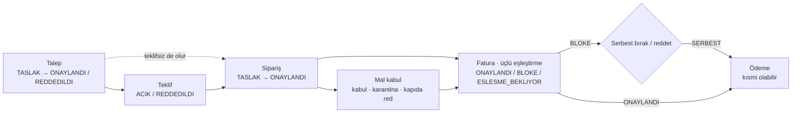
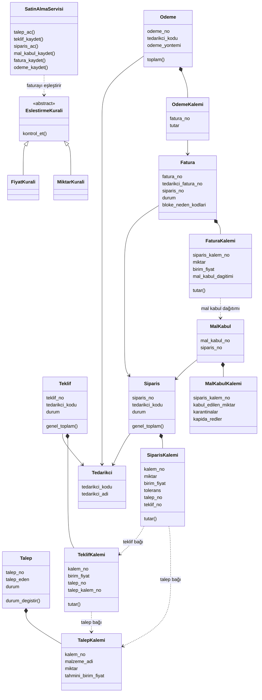

# Satın Alma Modülü

ERP mantığında satın alma süreci: **talep → teklif → sipariş → mal kabul → fatura → ödeme**,
kalbinde faturanın **üçlü eşleştirmesi** (three-way match). SAP MM'deki satın alma
ve fatura doğrulama (MM-IV) mantığını örnek alan, Python ile yazılmış katmanlı bir
terminal uygulaması.

> **Durum:** v1b tamamlandı. 100 otomatik test (`pytest`: 88 senaryo + 12 menü testi)
> ve menüden 14 elle test senaryosu geçiyor. Sıradaki sürüm v2 (bkz. Yol haritası).

## Ne yapar?

**Talep ve teklif (v1b)**
- Satın alma talebi açar; talep onaylanır ya da gerekçeyle reddedilir. Onaysız talepten
  sipariş ya da teklif açılamaz.
- Aynı talep için birden çok tedarikçiden teklif kaydeder, uygun olmayanı gerekçeyle reddeder.
- Tekliften tek adımda sipariş açar; malzeme adı, birim ve kategori talepten kopyalanır.
- Talep kalemi bölünebilir: siparişteki miktar talep miktarını aşamaz, aynı talep kalemi
  iki aktif siparişe bağlanamaz.

**Sipariş, mal kabul ve fatura (v1a)**
- Tedarikçi ekler, sipariş açar ve onaylar.
- Mal kabulde gelen miktarı üç kovaya ayırır: **kabul**, **karantina**, **kapıda red**
  (fazla teslimat toleransı ve aşırı sınıra göre).
- Faturayı sipariş ve mal kabulle karşılaştırır:
  - Miktar: faturalanan miktar kabul edilen miktarı aşamaz.
  - Fiyat: fatura net fiyatı, sipariş net fiyatının alt ve üst toleransı içinde olmalı.
  - Sonuç **ONAYLANDI** ya da nedeniyle birlikte **BLOKE** (ör. `FIYAT_YUKSEK`).
- Mal gelmeden gelen fatura **ESLESME_BEKLIYOR** durumunda bekler; mal kabul
  kaydedilince kendiliğinden eşleşir.
- BLOKE faturayı gerekçeyle **serbest bırakır** ya da **reddeder**; bloke nedeni
  kalem kalem gösterilir (beklenen, gelen, izin verilen fark).
- Karantinadaki fazla mal için **iade kararı** kaydeder (kısmi olabilir).
- Tolerans malzeme kategorisine göredir (SARF / STRATEJIK); sipariş açılırken kaleme kopyalanır.

**Ödeme (v1b)**
- Sadece ONAYLANDI ya da SERBEST durumdaki aktif faturalar ödenir.
- Kısmi ödeme yapılabilir; tek ödeme aynı tedarikçinin birden çok faturasını kapatabilir.
  Kalan borç aşılamaz.
- Ödeme bekleyen faturalar kalan borçlarıyla listelenir.

**Her yerde**
- Belgeler silinmez, gerekçeyle **iptal edilir**; zincir tersten çözülür
  (ödeme → fatura → mal kabul → sipariş → teklif → talep).
- Bekleyen işleri listeler: eşleşme bekleyen, bloke ve ödeme bekleyen faturalar, karantinadaki mal.
- Tutarlar `float` değil `Decimal` ile hesaplanır; Türkçe biçim (`1.250,50`).
- Bütün veri ve belge numaraları tek bir JSON dosyasında saklanır; program kapanıp açılınca
  geri gelir. Eski sürümün dosyası açılışta yeni biçime dönüştürülür.
- Güvenli yazma: dosya önce geçici dosyaya yazılır, sonra tek hamlede yer değiştirilir;
  yazma bozulursa eski dosya sağlam kalır, bellek de son sağlam hâle döner.
- Menüde numara sorulan her ekranda boş Enter ile vazgeçilir; hata satırları `Hata:` ile başlar.

## Akış



İptal zinciri tersten yürür: ödemesi olan fatura, faturası olan mal kabul, mal kabulü
olan sipariş, siparişe dönüşmüş teklif ve teklifi ya da siparişi olan talep iptal edilemez;
önce zincirin sonundaki belge iptal edilir.

## Sınıf diyagramı



Belgeler arası bağ numarayla kurulur (ör. sipariş kalemindeki `talep_no` + `talep_kalem_no`);
belgeler birbirinin nesnesini tutmaz. İş kuralları `SatinAlmaServisi`'ndedir, menü kural kontrol etmez.

## Kurulum

Python 3.11 veya üstü gerekir. Program dış kütüphane kullanmaz; testler için pytest gerekir.

```bash
git clone https://github.com/yusufbarlas/satin-alma-modulu.git
cd satin-alma-modulu
python -m venv .venv
.venv\Scripts\activate        # Windows
# source .venv/bin/activate   # macOS / Linux
pip install -r requirements.txt
```

## Çalıştırma

```bash
python ana.py          # terminal menüsü
pytest -v              # bütün testler (her testin adı ve PASSED / FAILED)
```

Menü gerçek veriyi `veri.json`'a yazar (Git'e girmez). Testler her seferinde
pytest'in açtığı geçici bir klasörde çalışır; gerçek veriye dokunmaz.

## Testler

| Dosya | Ne dener | Sayı |
|---|---|---|
| `test_senaryolar.py` | Servis üzerinden uçtan uca senaryolar: eşleştirme, toleranslar, iptaller, talep, teklif, ödeme, veri sürümü dönüşümü, güvenli yazma ve kayıt hatasında geri yükleme | 88 |
| `test_ana.py` | Menü: klavye girişi taklit edilir, ekran çıktısı ve kaydedilen veri kontrol edilir | 12 |

## Elle test (menü)

`python ana.py` ile boş veri dosyasından başlanarak iki oturumda denendi; ikinci oturumda
program kapatılıp açıldı. Her kaydın başında senaryo tablosu, altında ekran çıktısının tamamı var.

| Kayıt | Menü | Kapsam |
|---|---|---|
| `v1b-elle-test-kaydi.md` | 26 seçenekli v1b menüsü | M1-M14: talep, iki teklif ve red, tekliften sipariş, mal kabul, fatura, kısmi ve kalan ödeme, hatalı girişler, boş Enter ile vazgeçme, kapat-aç, iptal zinciri |
| `v1a-elle-test-kaydi.md` | v1a menüsü (eski numaralar) | M1-M14: sipariş, mal kabul ve karantina, bloke fatura ve serbest bırakma, malden önce gelen fatura, mükerrer fatura, iptal zinciri |

## Proje yapısı

| Dosya | Görevi |
|---|---|
| `ayarlar.py` | Sabitler: toleranslar, belge önekleri, gerekçe listeleri, ödeme yöntemleri, dosya adları |
| `hatalar.py` | Hata sınıfları (`SatinAlmaError` ve alt sınıfları); her hata bir kod taşır |
| `para.py` | Tutar çevirme (Türkçe biçim), yuvarlama, iskontolu net fiyat |
| `modeller.py` | Belgeler: Tedarikçi, Talep, Teklif, Sipariş, Mal kabul, Fatura, Ödeme ve kalemleri; durum geçişleri |
| `eslestirme.py` | Eşleştirme kuralları (miktar, fiyat) ve fazla teslimatın üç kova hesabı |
| `depolama.py` | JSON'a güvenli kaydetme, geri yükleme ve veri sürümü dönüşümü |
| `servis.py` | İş akışı: `SatinAlmaServisi` (belgeler arası kurallar burada) |
| `ana.py` | Terminal menüsü (kullanıcıyla konuşan tek dosya) |
| `test_senaryolar.py` · `test_ana.py` | Otomatik testler (pytest) |

Bağımlılık yönü tek: üstteki katman alttakini kullanır, tersi olmaz.

## Yol haritası

- **v1a:** sipariş, mal kabul, fatura, üçlü eşleştirme, iptaller, bloke faturayı serbest bırakma / reddetme, 52 test senaryosu (pytest)
- **v1a.1:** hata düzeltmeleri: aynı sipariş kalemi bir belgede iki satır girilemez; mükerrer fatura kontrolü boşluk ve büyük / küçük harf farkını yok sayar; birim küçük harfle saklanır; 56 test senaryosu
- **v1b:** satın alma talebi ve onayı, teklif ve tekliften sipariş, ödeme (kısmi, çok faturalı), hata kodları, veri sürümü dönüşümü, güvenli yazma, menü testleri ve menü okunaklılığı; 100 test
- **v2:** enum ve Türkçe durum etiketleri, tarih tipleri, loglama (denetim izi), tip ipuçları, paket yapısı, CI (her push'ta testler), kısmi teslimat, KDV, vergi numarası ve mükerrer tedarikçi kontrolü, menü düzeni
- **v3:** PostgreSQL, FastAPI, kullanıcı rolleri ve onay yetkisi
